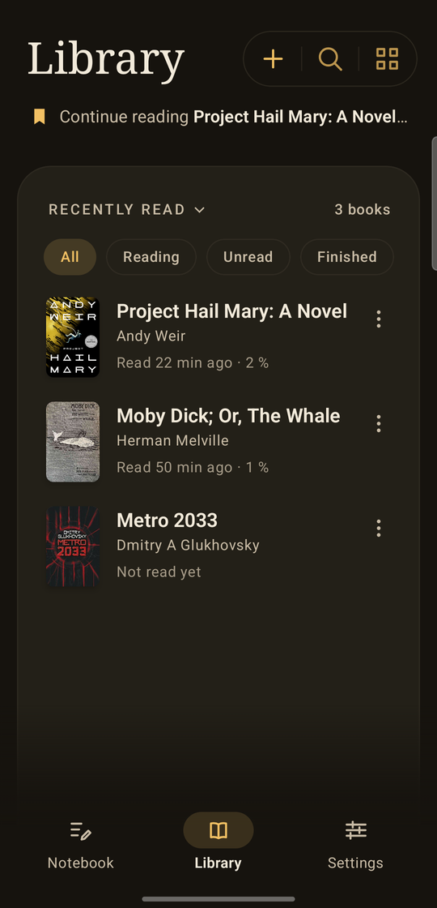
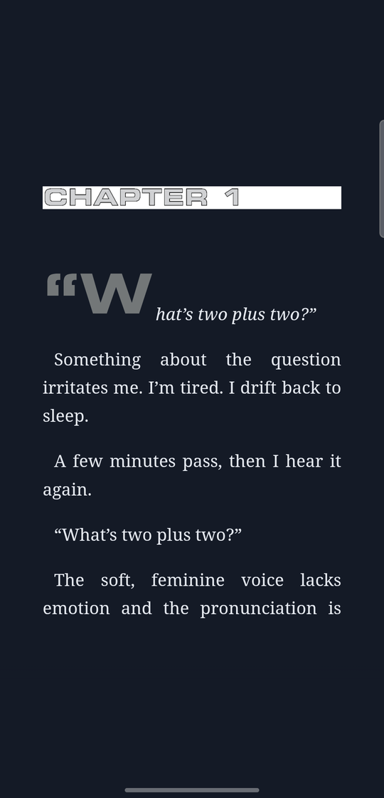
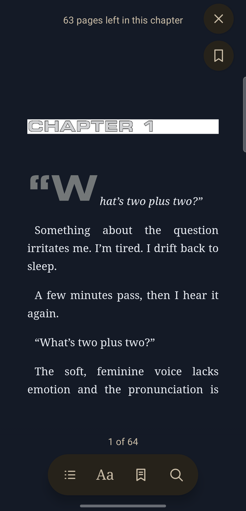
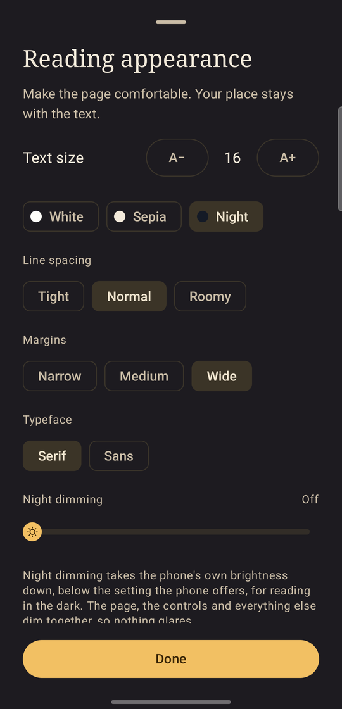
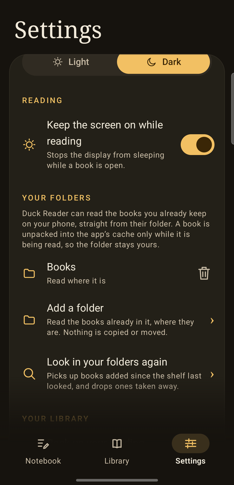
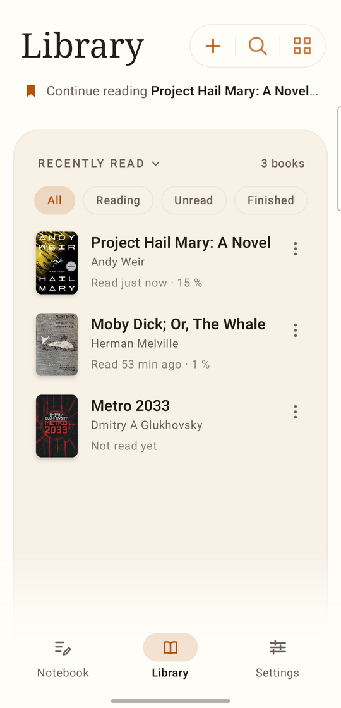

<div align="center">


<h1>Duck Reader</h1>

<p><strong>A quiet, folder-first ebook reader for Android.</strong></p>

<p>One page at a time. Your books stay in their folders, your places and marks stay on the device,<br />
and the app has no network permission at all.</p>

<p>
<a href="https://github.com/cristifcp/DuckReader/releases/latest"></a>
<a href="#install"></a>
<a href="https://kotlinlang.org"></a>
<a href="https://developer.android.com/jetpack/compose"></a>
<a href="LICENSE"></a>
<a href="#privacy"></a>
</p>

<p><a href="#install">Install</a> · <a href="#screenshots">Screenshots</a> · <a href="#features">Features</a> · <a href="#formats">Formats</a> · <a href="#build">Build</a> · <a href="docs/DESIGN.md">Design notes</a></p>

</div>

---

Most readers are built to sell you something. Duck Reader is built to be read: a page of paper,
one screen at a time, set the way you like it. Point it at a folder of DRM-free books and it lists
what is there without copying or moving a single file. There is no account, no feed, no analytics,
and no network permission to leak anything through.

## Install

Download the signed APK from [Releases](https://github.com/cristifcp/DuckReader/releases), open it on
the phone, and allow the installer to install from that app once. Android 8.0 (API 26) or newer.

Each release is built from its tag by this repository's own workflow and signed with the same key
every time, so updates install over the previous version and keep your places and marks.

<details>
<summary><b>Verify the signing certificate</b></summary>

```text
SHA-256: 20:28:6E:9D:D2:13:18:D4:4A:B2:80:99:4F:48:1D:2D:6D:69:17:FC:B9:A7:1A:E7:C4:EA:1D:27:35:17:77:FE
```

```bash
apksigner verify --print-certs app-release.apk
```

</details>

## Screenshots

<table>
  <tr>
    <td align="center" width="33%"><br /><sub><b>The shelf</b><br />Rows, covers, progress and one tap back into the last book.</sub></td>
    <td align="center" width="33%"><br /><sub><b>Reading</b><br />One page, no scrolling, nothing else on the screen.</sub></td>
    <td align="center" width="33%"><br /><sub><b>Controls</b><br />Pages left in the chapter, page number, and the pill.</sub></td>
  </tr>
  <tr>
    <td align="center" width="33%"><br /><sub><b>Appearance</b><br />Paper, type, spacing, margins and night dimming.</sub></td>
    <td align="center" width="33%"><br /><sub><b>Your folders</b><br />Add a folder once; the shelf scans it.</sub></td>
    <td align="center" width="33%"><br /><sub><b>Daylight</b><br />A warm light theme, or follow the phone.</sub></td>
  </tr>
</table>

## Features

**Reading**

- One page at a time, turned by a swipe or by tapping the screen edges — you choose which, and the
  two never compete for the same touch. A swipe acts when the finger lifts.
- A page turn that reads like paper: the arriving page travels in from the edge of the screen over
  the page being left, which darkens under its shadow and slips aside.
- The page and nothing else while you read. Tap the middle for the pages-left hint, the page number,
  and Contents, **Aa**, Bookmarks and Search.
- Text size, line spacing, margins and typeface, applied to the page already open.
- White, sepia and night paper; night dimming that takes the screen's own brightness below what the
  phone normally offers.
- A daylit theme and a warm night one, either chosen or following the phone.

**The shelf**

- **+** adds a folder of books already on the phone through Android's own folder picker. The shelf
  scans it, including subfolders, and remembers the grant.
- Books are read where they lie. Each one is unpacked into the app's cache when it is read; nothing
  is imported, copied into the library, or written back to the folder.
- Rows with cover, title, author and when the book was last put down, or a wall of covers if you
  prefer. Order by most recently read, title or author.
- Progress on every row, filters for what you are reading, what is unread and what is finished, and
  a single **Continue reading** line for the book opened most recently.
- Title and author search, a **Finished** mark on the last page, and a bookmark kept for every book.
- Remove a folder book from the shelf and its file is untouched; **Settings → Bring back removed
  books** puts it back. Removing a folder stops the shelf reading from it and keeps its books' marks.
- Books are not imported any more. **Open with** or a share says so and points at the folder route.
  Books imported by an earlier version stay on the shelf and remain readable.

**Marks and search**

- Whole-book search, listing each match with the words around it and the book's own chapter name;
  tapping a result reopens that passage.
- Highlights in yellow, mint, rose or lavender, notes on a marked passage, and bookmarks — each
  listed under the chapter name the book gives it, in **Contents**.
- A notebook that gathers every note from every book, where a note can be rewritten or dropped and
  the whole notebook saved as a Markdown file.
- Reading places are anchored to the text, so changing the font or screen size keeps your place in
  the words.

**Backup**

- **Settings → Back up your reading** writes one zip holding every reading place, bookmark,
  highlight, note and setting — but no book files, because the books live in your folders.
- Restoring only ever adds: a reading place moves only when the backup's is further along, and a note
  written since is never taken back. A backup made by an earlier version can still restore its books.
- To keep the books themselves, keep the folders they are in.

## Formats

A book is read from what it actually contains, not from its file extension. Folders are scanned for
`.epub`, `.fb2`, `.mobi`, `.prc` and `.azw` names; each file found is then recognised by its contents.

| Format | How it is read |
| --- | --- |
| **EPUB** 2 and 3 | As it is: the book's own package, chapters, covers and navigation. |
| **FictionBook (FB2)** | Converted into the same shape as an EPUB: a chapter per titled section, a contents list, images and linked footnotes. UTF-8 and windows-1251. |
| **MOBI** (PalmDOC) | Converted: records decompressed (plain, back-references, raw runs and the space-plus-letter code), split at the book's page breaks, with pictures and cover. |

Refused with a plain explanation rather than half-read: **DRM-protected** books, **AZW3**, MOBI
compressed with Amazon's Huffman dictionary, encrypted fonts, and fixed-layout or scripted EPUBs.
Calibre converts all of these to EPUB, which this app reads.

## Build

You need Android Studio (or a JDK 17+ and the Android SDK) and a phone or emulator running Android
8.0 (API 26) or newer. The project compiles against API 37.

```bash
git clone https://github.com/cristifcp/DuckReader.git
cd DuckReader

./gradlew :app:assembleDebug

# Install it on a connected device
adb install -r app/build/outputs/apk/debug/app-debug.apk
```

Or open the folder in Android Studio and press **Run**.

## Tests

```bash
./gradlew :app:testDebugUnitTest           # 117 unit tests, no device needed
./gradlew :app:lintDebug                   # Android lint
./gradlew :app:connectedDebugAndroidTest   # 163 tests on a connected phone or emulator
```

> **Careful with the device tests:** Android's instrumented-test task installs the app, runs the
> tests and, by default, **uninstalls it afterwards** — which erases the app's own data and any
> copies imported by an earlier version. `gradle.properties` sets
> `android.injected.androidTest.leaveApksInstalledAfterRun=true` so the app and its data stay put.
> Keep that line. Android's own cloud backup is off on purpose (`allowBackup="false"`), so
> **Settings → Back up your reading** is the way to keep your places and marks.

The format tests put hand-built EPUB, FictionBook and MOBI files through the real unpacking path and
read the result back, so a format can break loudly instead of quietly. Folder tests cover scanning,
cache rebuilding, removal and the reading a folder book keeps.

## Privacy

No account, no analytics, no ads, and no network permission. Reading places, bookmarks, highlights,
notes and settings stay in the app's private storage; the books stay in the folders they belong to.
A folder is only ever read, through the grant Android's folder picker gives, and only for the books
the shelf lists. A backup goes wherever you send it and nowhere else. Uninstalling the app deletes its
own data — and any copies imported by an earlier version — which is what the backup is for. The
folders and the books in them are never touched.

## Status and limits

This is a working reader, developed and used as a daily driver, not a finished product. Known limits:
the page is rendered by Android's WebView with the app's own pagination code (not Readium yet); a
folder's first scan unpacks the books it finds into the app's cache, so a large folder takes a while
to appear and Android may clear that cache at any time (opening a book rebuilds its copy from the
file); folders are looked through when the app starts, when one is added, and when Settings asks; page
numbers count within the file being read, while the chapter name and the pages-left hint follow the
book's own chapters; search matches within one paragraph; there is no PDF and no text-to-speech. The
long version of every decision is in [docs/DESIGN.md](docs/DESIGN.md).

## Documentation

- [Design notes](docs/DESIGN.md) — why the page turns the way it does, how a folder is scanned, what
  is deliberately left out.
- [Release notes](CHANGELOG.md) — what changed, and when.
- [Releasing](RELEASING.md) — how a tagged build is signed and published.

## License

[GNU General Public License v3.0](LICENSE). You may use, study, share and modify this app; if you
distribute it or a modified version, the source has to stay open under the same license.

## Credits

- The duck reading a book is part of this project's artwork.
